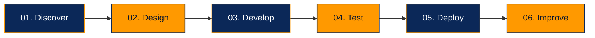

<div align="center">


<a href="https://adiyogitechnosoft.com/">
  
</a>
<a href="https://github.com/AdiyogiTech">
  
</a>
<a href="https://github.com/AdiyogiTech?tab=repositories">
  
</a>

<br/>


**Turning Ideas Into Powerful Digital Experiences**

</div>

---

## `> who_we_are`

We are **Adiyogi Technosoft Pvt. Ltd.**, a software development company focused on creating modern, scalable, and user-friendly digital solutions.

We transform business ideas into functional software through thoughtful engineering, clean interfaces, and reliable technology.

```text
┌───────────────────────────────────────────────┐
│  ADIYOGI TECHNOSOFT                            │
│                                               │
│  > Design                                      │
│  > Develop                                     │
│  > Integrate                                   │
│  > Innovate                                    │
│                                               │
│  Building technology for real-world impact.    │
└───────────────────────────────────────────────┘
```

## `> our_services`

<table>
<tr>
<td width="50%" valign="top">

### 📱 Mobile Engineering

- Flutter applications
- Android & iOS development
- Firebase integration
- Push notifications
- Third-party API integration

</td>
<td width="50%" valign="top">

### 🌐 Web Engineering

- Business websites
- Web applications
- Admin panels & dashboards
- Backend API integration
- Responsive interfaces

</td>
</tr>
<tr>
<td width="50%" valign="top">

### ⚙️ Backend & Cloud

- REST API integration
- Database solutions
- Authentication systems
- Cloud-connected applications
- Business workflow automation

</td>
<td width="50%" valign="top">

### 🎨 UI/UX & Product Design

- Modern interfaces
- User-focused experiences
- Interactive prototypes
- Cross-device layouts
- Product optimization

</td>
</tr>
</table>

## `> technology_stack`

<div align="center">

### Mobile Development


### Web Development


### Backend & Database


### Development Tools


</div>

## `> featured_work`

We develop digital products for different business needs.

<table>
<tr>
<td width="50%" valign="top">

### 🛒 Customer Platforms

Customer-facing applications with product discovery, account management, and integrated services.

</td>
<td width="50%" valign="top">

### 🏠 Smart Applications

Solutions for managing household information, expenses, services, and everyday workflows.

</td>
</tr>
<tr>
<td width="50%" valign="top">

### 📍 Location-Based Solutions

Applications with maps, location services, navigation, and real-time integrations.

</td>
<td width="50%" valign="top">

### 🔔 Connected Systems

Applications integrating APIs, cloud services, notifications, and data-driven workflows.

</td>
</tr>
</table>

Explore our available code:

<div align="center">

<a href="https://github.com/AdiyogiTech?tab=repositories">
  
</a>

</div>

## `> our_engineering_principles`

| Principle | Our Focus |
|---|---|
| `01` Innovation | Practical, modern technology |
| `02` Quality | Readable, maintainable code |
| `03` User Experience | Intuitive digital products |
| `04` Reliability | Robust application workflows |
| `05` Collaboration | Transparent development |

## `> development_workflow`



## `> let's_build_together`

Have a project idea, need a mobile application, or want to modernize your business software?

**Let's turn your vision into a digital product.**

<div align="center">

<a href="https://adiyogitechnosoft.com/">
  
</a>

<a href="https://github.com/AdiyogiTech">
  
</a>

<br/><br/>

**ADIYOGI TECHNOSOFT PVT. LTD.**

`INNOVATE` &nbsp; • &nbsp; `ENGINEER` &nbsp; • &nbsp; `DELIVER`

<sub>Building reliable digital experiences, one solution at a time.</sub>

</div>
